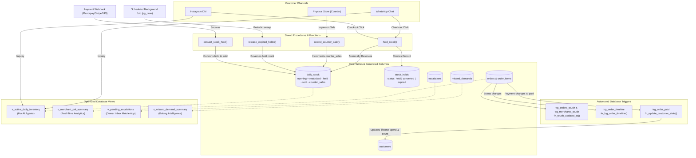

# Database Logic: Functions, Triggers & Views

> **Reference File**: `supabase/migrations/20261026000000_enterprise_schema.sql`  
> **Target Schema**: Sellix Enterprise Multi-Tenant SaaS (Bakery & Direct-to-Consumer Commerce)

---

## Architecture Overview



---

## 1. Stored Procedures & Business Functions

Stored procedures encapsulate critical transactional operations directly in PostgreSQL, eliminating network round-trips and race conditions between concurrent requests.

---

### 1.1 `hold_stock(p_variant_id, p_conversation_id, p_quantity, p_hold_minutes)`

* **Schema Location**: Section 5 (`hold_stock`)
* **Return Type**: `UUID` (The generated `stock_holds.id`)
* **Default Hold Time**: `15 minutes`

#### What It Does
Atomically checks available inventory and reserves a requested quantity of an item for an active chat conversation during checkout.

#### What Is the Use of This?
In conversational commerce (Instagram DMs, WhatsApp), multiple buyers frequently ask for the same limited item (e.g., the last 2 boxes of chocolate croissants). If a payment link is sent without holding stock, multiple customers could pay simultaneously, causing overselling and customer disputes. 

`hold_stock()` solves this with strict row-level atomicity:
1. It updates `daily_stock` by incrementing `held = held + p_quantity` **only if**:
   $$\text{opening\_stock} + \text{restocked} - \text{held} - \text{sold} - \text{counter\_sales} \ge p\_quantity$$
2. If available stock is insufficient, `GET DIAGNOSTICS ROW_COUNT` returns `0`, and an exception `INSUFFICIENT_STOCK: Item is sold out or unavailable` is raised immediately, aborting the transaction.
3. If successful, it creates a row in `stock_holds` with status `'held'` and expiry set to `NOW() + interval`.

#### Practical SQL Example
```sql
SELECT hold_stock(
    p_variant_id       := 'a1b2c3d4-1111-2222-3333-444455556666',
    p_conversation_id  := 'b2c3d4e5-2222-3333-4444-555566667777',
    p_quantity         := 2,
    p_hold_minutes     := 15
);
-- Returns: 'e8f9a0b1-3333-4444-5555-666677778888' (Hold ID)
```

---

### 1.2 `convert_stock_hold(p_hold_id)`

* **Schema Location**: Section 5 (`convert_stock_hold`)
* **Return Type**: `VOID`

#### What It Does
Transforms a temporary reservation into a permanent, finalized sale in the daily inventory ledger.

#### What Is the Use of This?
When the merchant receives a verified webhook from Razorpay, Stripe, or UPI confirming the customer completed payment:
1. It locks the hold row using `SELECT ... FOR UPDATE` to avoid double-processing.
2. Checks that `status` is currently `'held'`.
3. In `daily_stock`, shifts the inventory from temporary hold to confirmed sale:
   ```sql
   held = held - v_quantity,
   sold = sold + v_quantity
   ```
4. Flips the hold record status in `stock_holds` to `'converted'`.

#### Practical SQL Example
```sql
-- Triggered by payment confirmation webhook worker
SELECT convert_stock_hold('e8f9a0b1-3333-4444-5555-666677778888');
```

---

### 1.3 `release_expired_holds()`

* **Schema Location**: Section 5 (`release_expired_holds`)
* **Return Type**: `INT` (Total number of expired reservations released)

#### What It Does
Finds all reservations that expired without being paid and releases their held quantities back into available inventory.

#### What Is the Use of This?
If a customer receives a payment link in Instagram DM but gets distracted, navigates away, or abandons checkout, their reserved stock shouldn't remain blocked forever.
1. Sweeps `stock_holds` for records where `status = 'held' AND expires_at < NOW()`.
2. For each expired hold, decrements `daily_stock.held = held - r.quantity` for the current date.
3. Updates `stock_holds.status = 'expired'`.
4. Returns the total count of restored slots so monitoring jobs can log cleanup activity.
5. Invoked every 1–2 minutes via background schedulers (e.g., `pg_cron` or backend workers).

#### Practical SQL Example
```sql
-- Run by periodic background cron
SELECT release_expired_holds();
-- Output: 3 (3 abandoned holds released back into stock)
```

---

### 1.4 `record_counter_sale(p_variant_id, p_quantity)`

* **Schema Location**: Section 5 (`record_counter_sale`)
* **Return Type**: `INT` (Remaining `available` stock after this counter sale)

#### What It Does
Records direct walk-in physical store sales on the daily stock ledger and instantly returns the new real-time online availability.

#### What Is the Use of This?
Home bakers and boutique stores sell through both physical walk-ins and digital chats. When a walk-in customer buys 5 brownies at the register (*"5 brownies counter-la poyiduchu"*), the owner or POS clerk enters this into the merchant app.
1. Atomically increments `daily_stock.counter_sales = counter_sales + p_quantity`.
2. PostgreSQL's generated column `available` automatically recalculates:
   $$\text{available} = \text{opening\_stock} + \text{restocked} - \text{held} - \text{sold} - \text{counter\_sales}$$
3. Returns `available` immediately so the cashier app can alert the merchant if stock has run out.
4. Prevents online AI agents from offering or selling inventory that was already purchased at the physical store counter.

#### Practical SQL Example
```sql
SELECT record_counter_sale(
    p_variant_id := 'a1b2c3d4-1111-2222-3333-444455556666',
    p_quantity   := 5
);
-- Returns: 12 (12 units still available for online AI sales today)
```

---

### 1.5 `rollover_daily_stock(p_merchant_id, p_from_date, p_to_date)`

* **Schema Location**: Migration `20261027210000_stock_modes_and_rollover.sql`
* **Return Type**: `INT` (Number of variants rolled forward into tomorrow's opening stock)

#### What It Does
Carries forward unsold available stock from yesterday (`p_from_date`) into today's opening stock (`p_to_date`) for perpetual items (`stock_mode = 'inventory'`) and multi-day goods (`shelf_life_days > 1`).

#### What Is the Use of This?
Home bakers, cloud kitchens, and D2C boutique merchants have both single-day perishable items (fresh cream cakes, cut flowers) and shelf-stable goods (cookies, brownies, jarred treats, apparel, plants, slippers).
1. At the merchant's closing time or midnight cron, `rollover_daily_stock` sweeps all active variants with `available > 0` on `p_from_date`.
2. For items configured with `stock_mode = 'inventory'` (perpetual non-perishables) or multi-day perishables (`shelf_life_days > 1`), it inserts or updates tomorrow's `daily_stock` row with:
   $$\text{opening} = \text{daily\_stock.opening} + \text{available}_{\text{yesterday}}$$
3. Pure 1-day perishables (fresh cream cakes, daily specials with `shelf_life_days = 1`) are untouched and left at 0 opening stock until fresh morning bakes are entered.
4. Paired with `GET /v1/today/leftovers` and `POST /v1/today/rollover`, merchants can also interactively customize exact leftover counts (e.g., choose 4 out of 10 cookies to sell online today while saving 6 for counter/personal use).

#### Practical SQL Example
```sql
SELECT rollover_daily_stock(
    p_merchant_id := 'c3d4e5f6-3333-4444-5555-666677778888',
    p_from_date   := CURRENT_DATE - INTERVAL '1 day',
    p_to_date     := CURRENT_DATE
);
-- Returns: 7 (7 perpetual and multi-day variants rolled over into today's opening ledger)
```

---

## 2. Database Triggers & Trigger Functions

Database triggers guarantee business rules and data consistency regardless of which service or API modifies the database.

| Trigger Name | Target Table | Timing & Event | Trigger Function | Business Purpose & Use Case |
| :--- | :--- | :--- | :--- | :--- |
| **`trg_merchants_touch`** | `merchants` | `BEFORE UPDATE` | `fn_touch_updated_at` | Keeps `updated_at` current on tenant profile changes. |
| **`trg_orders_touch`** | `orders` | `BEFORE UPDATE` | `fn_touch_updated_at` | Automatically updates `orders.updated_at = NOW()` for accurate change tracking. |
| **`trg_order_timeline`** | `orders` | `AFTER UPDATE OF status` | `fn_log_order_timeline` | Immutable audit log of every order status transition (`draft` $\rightarrow$ `confirmed` $\rightarrow$ `ready` $\rightarrow$ `delivered`). |
| **`trg_order_paid`** | `orders` | `AFTER UPDATE OF payment_status` | `fn_update_customer_stats` | Live CRM updates: recalculates lifetime orders count and lifetime monetary spend on customer profiles. |

---

### Detailed Trigger Breakdown

#### 2.1 `fn_touch_updated_at()`
* **Schema Location**: Section 6 (`fn_touch_updated_at`)
* **Triggers**: `trg_merchants_touch`, `trg_orders_touch`
* **Execution**: Fires `BEFORE UPDATE ON merchants` and `BEFORE UPDATE ON orders` for each row.
* **Mechanism**: Sets `NEW.updated_at = NOW()`.
* **Value**: Ensures clients, sync workers, and cache layers (e.g., Redis / HTTP ETags) always know the exact timestamp when an order or merchant configuration was last altered without having to manually pass timestamps from backend code.

#### 2.2 `fn_log_order_timeline()`
* **Schema Location**: Section 6 (`fn_log_order_timeline`)
* **Trigger**: `trg_order_timeline AFTER UPDATE OF status ON orders`
* **Mechanism**:
  ```sql
  IF (OLD.status IS DISTINCT FROM NEW.status) THEN
      INSERT INTO order_timeline (
          order_id, from_status, to_status, triggered_by, comment
      ) VALUES (
          NEW.id, OLD.status, NEW.status, 'system', 'Order status updated'
      );
  END IF;
  ```
* **Value**:
  - Provides a 100% tamper-evident audit history of order lifecycles.
  - Helps resolve customer support disputes ("When did my cake go out for delivery?").
  - Powers timeline UI widgets on customer tracking web pages.

#### 2.3 `fn_update_customer_stats()`
* **Schema Location**: Section 6 (`fn_update_customer_stats`)
* **Trigger**: `trg_order_paid AFTER UPDATE OF status ON orders` (supporting both `status` and `payment_status` settlement in lockstep)
* **Mechanism**:
  ```sql
  IF (OLD.payment_status <> 'paid' AND NEW.payment_status = 'paid') OR
     (OLD.status <> 'paid' AND NEW.status = 'paid') THEN
      UPDATE customers
      SET lifetime_orders_count = lifetime_orders_count + 1,
          lifetime_spent_minor = lifetime_spent_minor + NEW.total_amount_minor
      WHERE id = NEW.customer_id;
  END IF;
  ```
* **Value**:
  - Automatically identifies High-Value Customers (VIPs) for special treatment or discounts.
  - Informs the AI agent during conversations (e.g., *"Welcome back! You've placed 12 orders with us"*).
  - Eliminates slow `SUM(orders.total_amount)` aggregations over millions of rows whenever a customer profile is fetched.

---

## 3. Database Views

Views present pre-computed, optimized abstractions over complex multi-table joins, purpose-built for specific consumer clients.

---

### 3.1 `v_active_daily_inventory`
* **Schema Location**: Section 7 (`v_active_daily_inventory`)
* **Primary Consumer**: Dual-Channel AI Agents (WhatsApp & Instagram DM bots).

#### What It Does
Joins `products`, `product_variants`, `daily_stock`, and `story_registry` to expose what items are available *today*, their prices, real-time stock balances, and any linked Instagram Story menu images.

#### Column Reference
| Column | Type | Description |
| :--- | :--- | :--- |
| `merchant_id` | `UUID` | Multi-tenant merchant isolation ID |
| `product_id` | `UUID` | Parent product catalog ID |
| `product_name` | `VARCHAR(255)` | Main item title (e.g., "Fudge Brownie Box") |
| `variant_id` | `UUID` | Unique variant ID needed to reserve stock |
| `variant_name` | `VARCHAR(150)` | Size/flavor (e.g., "Pack of 6", "500g Eggless") |
| `selling_price_minor` | `BIGINT` | Price in minor currency units (paise / cents) |
| `available` | `INT` | Computed real-time stock available right now |
| `menu_image_url` | `TEXT` | Cached image URL from active Instagram Story menu |

#### Query Example for the AI Agent
```sql
SELECT product_name, variant_name, selling_price_minor / 100.0 AS price_inr, available, menu_image_url
FROM v_active_daily_inventory
WHERE merchant_id = 'c1d2e3f4-0000-0000-0000-000000000001'
  AND available > 0;
```

---

### 3.2 `v_merchant_pnl_summary`
* **Schema Location**: Section 7 (`v_merchant_pnl_summary`)
* **Primary Consumer**: Merchant Web Dashboard & Analytics Reports.

#### What It Does
Aggregates sales, costs, delivery fees, payment gateway processing fees, and customer refunds by merchant and date to deliver a real-time Profit & Loss statement.

#### Profit Calculation Formula
$$\text{Net Profit} = \text{Gross Sales} - \text{COGS} - \text{Delivery Fees} - \text{Gateway Fees} - \text{Refunds}$$

#### Column Reference
| Column | Type | Description |
| :--- | :--- | :--- |
| `merchant_id` | `UUID` | Merchant ID |
| `order_date` | `DATE` | Grouping calendar date |
| `total_orders` | `BIGINT` | Total confirmed non-cancelled orders |
| `gross_sales_minor` | `BIGINT` | Total revenue in paise |
| `total_cogs_minor` | `BIGINT` | Cost of Goods Sold (ingredient / product cost) |
| `total_delivery_fees_minor` | `BIGINT` | Delivery fees billed to customers |
| `total_gateway_fees_minor` | `BIGINT` | Payment gateway charges (Razorpay / Stripe) |
| `total_refunds_minor` | `BIGINT` | Deductions for returned or cancelled orders |
| `net_profit_minor` | `BIGINT` | True bottom-line net profit |

#### Query Example for Owner Dashboard
```sql
SELECT 
    order_date,
    total_orders,
    gross_sales_minor / 100.0 AS sales_inr,
    total_cogs_minor / 100.0  AS cogs_inr,
    net_profit_minor / 100.0  AS net_profit_inr
FROM v_merchant_pnl_summary
WHERE merchant_id = 'c1d2e3f4-0000-0000-0000-000000000001'
ORDER BY order_date DESC
LIMIT 30;
```

---

### 3.3 `v_pending_escalations`
* **Schema Location**: Section 7 (`v_pending_escalations`)
* **Primary Consumer**: Merchant Owner Mobile App (Flutter / React Native).

#### What It Does
Presents an actionable triage queue for customer requests the AI agent could not automatically answer (custom cake design requests, allergy confirmations, bulk corporate discounts, or uploaded reference photos).

#### Column Reference
| Column | Type | Description |
| :--- | :--- | :--- |
| `escalation_id` | `UUID` | ID for updating/resolving the escalation |
| `merchant_id` | `UUID` | Merchant ID |
| `conversation_id` | `UUID` | Active conversation thread ID |
| `customer_name` | `VARCHAR(150)` | Customer's full name |
| `customer_phone` | `VARCHAR(30)` | Customer's phone number |
| `channel` | `VARCHAR(50)` | Source channel (`whatsapp` or `instagram_dm`) |
| `customer_question` | `TEXT` | Unanswered inquiry or special instruction |
| `customer_photo_url` | `TEXT` | Uploaded reference photo from DM |
| `created_at` | `TIMESTAMPTZ` | Timestamp of escalation |

#### Query Example for Owner App Push/Inbox
```sql
SELECT escalation_id, customer_name, channel, customer_question, customer_photo_url, created_at
FROM v_pending_escalations
WHERE merchant_id = 'c1d2e3f4-0000-0000-0000-000000000001'
ORDER BY created_at ASC;
```

---

### 3.4 `v_missed_demand_summary`
* **Schema Location**: Section 7 (`v_missed_demand_summary`)
* **Primary Consumer**: End-of-Day (EOD) Analytics & AI Production Advisor.

#### What It Does
Aggregates customer queries where an item was requested but could not be fulfilled (e.g., sold out, shop closed, or unlisted flavor). Answers the owner's question: *"What should I bake more of tomorrow?"*

#### Column Reference
| Column | Type | Description |
| :--- | :--- | :--- |
| `merchant_id` | `UUID` | Merchant ID |
| `requested_item_name` | `VARCHAR(150)` | Item or flavor customer asked for |
| `reason` | `VARCHAR(50)` | `sold_out`, `shop_closed`, or `not_in_catalog` |
| `request_count` | `BIGINT` | Number of individual customer inquiries |
| `total_units_missed` | `BIGINT` | Estimated quantity of missed sales |

#### Query Example for Baking Recommendation
```sql
SELECT requested_item_name, reason, request_count, total_units_missed
FROM v_missed_demand_summary
WHERE merchant_id = 'c1d2e3f4-0000-0000-0000-000000000001'
ORDER BY total_units_missed DESC;
```

---

## 4. Performance Indexes Supporting Views & Functions

To maintain sub-millisecond query responses under high conversation concurrency, the following indexes are specifically configured:

* `idx_daily_stock_variant_date`: Accelerates `hold_stock()` and `record_counter_sale()` lookups on `daily_stock(variant_id, stock_date)`.
* `idx_stock_holds_active`: Makes `release_expired_holds()` run instantly via `stock_holds(variant_id, status, expires_at)`.
* `idx_orders_merchant_date`: Powers the date-bucketed aggregations in `v_merchant_pnl_summary`.
* `idx_story_registry_lookup`: Speeds up image joins in `v_active_daily_inventory`.