# Database Logic: Functions, Triggers & Views

> **Reference Files**:
> - `supabase/migrations/20261026000000_enterprise_schema.sql`
> - `supabase/migrations/20261027200000_stock_holds_order_sync.sql`
> - `supabase/migrations/20261027210000_stock_modes_and_rollover.sql`
> - `supabase/migrations/20261028000000_enterprise_schema_alignment.sql`
> - `supabase/migrations/20261028100000_fix_duplications_and_pnl.sql`  
> **Target Schema**: Sellix Enterprise Multi-Tenant SaaS (India-Only `Asia/Kolkata` IST · `INR`)

---

## Architecture Overview

```mermaid
flowchart TD
    subgraph Channels["Customer & Merchant Channels"]
        WA["WhatsApp Chat"]
        IG["Instagram DM"]
        Counter["Physical Store (Counter POS)"]
    end

    subgraph LogicLayer["Stored Procedures & Inventory Service"]
        F1["hold_stock() / inventory.hold()"]
        F2["convert_stock_hold() / inventory.confirm_sale()"]
        F3["release_expired_holds()"]
        F4["record_counter_sale()"]
        F5["rollover_daily_stock()"]
    end

    subgraph DB["Canonical Single-Source-of-Truth Tables"]
        DS[("daily_stock<br/>business_date (IST)<br/>opening + restocked - held - sold - counter_sales")]
        SH[("stock_holds<br/>business_date (IST), order_id<br/>status: held | converted | expired | cancelled")]
        ORD[("orders & order_items<br/>status | payment_status | fulfilment_status<br/>total_minor, total_cost_minor, shipping_minor")]
        OE[("order_events<br/>actor: agent | merchant | paypal | customer | system")]
        PAY[("payments<br/>provider, method, kind, amount_minor, fee_minor")]
        REF[("refunds<br/>refund_amount_minor, is_restocked")]
        CUST[("customers<br/>lifetime_orders_count, lifetime_spent_minor")]
        ESC[("escalations")]
        MD[("missed_demands")]
    end

    subgraph Triggers["Automated Database Triggers"]
        T1["trg_orders_touch & set_updated_at()"]
        T2["trg_order_items_sync & trg_order_items_recalc_cost<br/>Auto-snapshots COGS (unit_cost_minor -> total_cost_minor)"]
        T3["trg_order_paid<br/>fn_update_customer_stats() (Increment on paid, decrement on refund)"]
    end

    subgraph Views["Optimized Database Views"]
        V0["order_timeline (View over order_events)<br/>Preserves real actor & merchant comments"]
        V1["v_active_daily_inventory<br/>(Real-Time IST Stock & Live Variant Price)"]
        V2["v_merchant_pnl_summary<br/>(Pre-aggregated Payments, COGS & Refunds by IST business_date)"]
        V3["v_pending_escalations<br/>(Owner Inbox Mobile App)"]
        V4["v_missed_demand_summary<br/>(IST Baking / Stock Intelligence)"]
    end

    WA -->|Inquiry| V1
    IG -->|Inquiry| V1
    WA -->|Checkout Click| F1
    IG -->|Checkout Click| F1
    Counter -->|In-person Sale| F4
    F1 -->|Atomically Reserves| DS
    F1 -->|Creates Record| SH
    F4 -->|Increments counter_sales| DS

    Cron["Scheduled Background Job"] -->|Periodic sweep| F3
    F3 -->|Reverses held count & logs expired| DS
    F3 -->|Syncs order & event| ORD
    PaymentWebhook["Payment Settlement (PayPal / UPI / Cash)"] -->|Success| F2
    F2 -->|Converts hold to sold| DS

    ORD --> T1
    ORD --> T2
    ORD -->|Status / Payment changes| T3
    T3 -->|Updates lifetime spend & count| CUST
    OE -.-> V0
    DS -.-> V1
    ORD -.-> V2
    PAY -.-> V2
    REF -.-> V2
    ESC -.-> V3
    MD -.-> V4
```



---

## 1. Stored Procedures & Business Functions

Stored procedures encapsulate critical transactional operations directly in PostgreSQL, eliminating network round-trips and race conditions between concurrent requests. All date-scoped operations default to **Indian Standard Time (`Asia/Kolkata`)** rather than server UTC (`CURRENT_DATE`), preventing midnight–5:30 AM IST date drift.

---

### 1.1 `hold_stock(p_variant_id, p_conversation_id, p_quantity, p_hold_minutes, p_business_date, p_order_id)`

* **Schema Location**: `20261028100000_fix_duplications_and_pnl.sql` (`hold_stock`)
* **Return Type**: `UUID` (The generated `stock_holds.id`)
* **Defaults**: `p_hold_minutes = 15`, `p_business_date = (NOW() AT TIME ZONE 'Asia/Kolkata')::date`, `p_order_id = NULL`

#### What It Does
Atomically checks available inventory on the merchant's IST `business_date` and reserves a requested quantity of an item for an active order or chat conversation during checkout.

#### What Is the Use of This?
In conversational commerce (Instagram DMs, WhatsApp), multiple buyers frequently ask for the same limited item (e.g., the last 2 boxes of chocolate croissants). If a payment link is sent without holding stock, multiple customers could pay simultaneously, causing overselling and customer disputes. 

`hold_stock()` (and its Python counterpart `inventory.hold()`) solves this with strict row-level atomicity:
1. It updates `daily_stock` on `business_date = p_business_date` by incrementing `held = held + p_quantity` **only if**:
   $$\text{opening} + \text{restocked} - \text{held} - \text{sold} - \text{counter\_sales} \ge p\_quantity$$
2. If available stock is insufficient, `GET DIAGNOSTICS ROW_COUNT` returns `0`, and an exception `INSUFFICIENT_STOCK: Item is sold out or unavailable` is raised immediately, aborting the transaction.
3. If successful, it creates a row in `stock_holds` storing `business_date = p_business_date`, `order_id = p_order_id`, status `'held'`, and expiry set to `NOW() + interval`.

#### Practical SQL Example
```sql
SELECT hold_stock(
    p_variant_id       := 'a1b2c3d4-1111-2222-3333-444455556666',
    p_conversation_id  := 'b2c3d4e5-2222-3333-4444-555566667777',
    p_quantity         := 2,
    p_hold_minutes     := 15,
    p_business_date    := (NOW() AT TIME ZONE 'Asia/Kolkata')::date,
    p_order_id         := 'd4e5f6a7-4444-5555-6666-777788889999'
);
-- Returns: 'e8f9a0b1-3333-4444-5555-666677778888' (Hold ID)
```

---

### 1.2 `convert_stock_hold(p_hold_id)`

* **Schema Location**: `20261028100000_fix_duplications_and_pnl.sql` (`convert_stock_hold`)
* **Return Type**: `VOID`

#### What It Does
Transforms a temporary reservation into a permanent, finalized sale in the daily inventory ledger on the hold's stored `business_date`.

#### What Is the Use of This?
When the merchant confirms a payment (or receives a verified webhook from PayPal, Razorpay, or Cashfree):
1. It locks the hold row using `SELECT ... FOR UPDATE` to avoid double-processing.
2. Checks that `status` is currently `'held'`.
3. Resolves the exact `business_date` from the linked `orders.business_date` or `stock_holds.business_date` (falling back to `(NOW() AT TIME ZONE 'Asia/Kolkata')::date`).
4. In `daily_stock`, shifts the inventory from temporary hold to confirmed sale:
   ```sql
   held = held - v_quantity,
   sold = sold + v_quantity
   ```
5. Flips the hold record status in `stock_holds` to `'converted'`.

#### Practical SQL Example
```sql
-- Triggered by payment confirmation webhook worker
SELECT convert_stock_hold('e8f9a0b1-3333-4444-5555-666677778888');
```

---

### 1.3 `release_expired_holds()`

* **Schema Location**: `20261028100000_fix_duplications_and_pnl.sql` (`release_expired_holds`)
* **Return Type**: `INT` (Total number of expired reservations released)

#### What It Does
Finds all reservations that expired without being paid, releases their held quantities back into available inventory on the hold's exact `business_date`, marks linked orders `'expired'`, and records an `'expired'` audit event in `order_events`.

#### What Is the Use of This?
If a customer receives a payment link in Instagram DM at 11:50 PM IST and abandons checkout so it expires at 12:05 AM IST (after midnight):
1. Sweeps `stock_holds` for records where `status = 'held' AND expires_at < NOW()` (`FOR UPDATE SKIP LOCKED`).
2. Decrements `daily_stock.held = held - r.quantity` on `COALESCE(orders.business_date, stock_holds.business_date, (created_at AT TIME ZONE 'Asia/Kolkata')::date)` — ensuring holds crossing midnight release stock on the exact business date they were reserved from.
3. Updates `stock_holds.status = 'expired'`.
4. If linked to an order (`r.order_id IS NOT NULL`), updates `orders.status = 'expired'` and inserts an `'expired'` row into `order_events` (`actor = 'system'`).

#### Practical SQL Example
```sql
-- Run by periodic background cron
SELECT release_expired_holds();
-- Output: 3 (3 abandoned holds released back into stock)
```

---

### 1.4 `record_counter_sale(p_variant_id, p_quantity, p_business_date)`

* **Schema Location**: `20261028100000_fix_duplications_and_pnl.sql` (`record_counter_sale`)
* **Return Type**: `INT` (Remaining `available` stock after this counter sale)
* **Default Date**: `p_business_date = (NOW() AT TIME ZONE 'Asia/Kolkata')::date`

#### What It Does
Records direct walk-in physical store sales on the daily stock ledger (only if `available >= p_quantity`) and instantly returns the new real-time online availability.

#### Practical SQL Example
```sql
SELECT record_counter_sale(
    p_variant_id    := 'a1b2c3d4-1111-2222-3333-444455556666',
    p_quantity      := 5,
    p_business_date := (NOW() AT TIME ZONE 'Asia/Kolkata')::date
);
-- Returns: 12 (12 units still available for online AI sales today)
```

---

### 1.5 `rollover_daily_stock(p_merchant_id, p_from_date, p_to_date)`

* **Schema Location**: Migration `20261027210000_stock_modes_and_rollover.sql`
* **Return Type**: `INT` (Number of variants rolled forward into tomorrow's opening stock)

#### What It Does
Carries forward unsold available stock from yesterday (`p_from_date`) into today's opening stock (`p_to_date`) for perpetual items (`stock_mode = 'inventory'`) and multi-day goods (`shelf_life_days > 1`).

#### What Is the Use of This?
Home bakers, cloud kitchens, and D2C boutique merchants have both single-day perishable items (fresh cream cakes, cut flowers) and shelf-stable goods (cookies, brownies, jarred treats, apparel, plants, slippers).
1. At the merchant's closing time or midnight cron, `rollover_daily_stock` sweeps all active variants with `available > 0` on `p_from_date`.
2. For items configured with `stock_mode = 'inventory'` (perpetual non-perishables) or multi-day perishables (`shelf_life_days > 1`), it inserts or updates tomorrow's `daily_stock` row with:
   $$\text{opening} = \text{daily\_stock.opening} + \text{available}_{\text{yesterday}}$$
3. Pure 1-day perishables (fresh cream cakes, daily specials with `shelf_life_days = 1`) are untouched and left at 0 opening stock until fresh morning bakes are entered.
4. Paired with `GET /v1/today/leftovers` and `POST /v1/today/rollover`, merchants can also interactively customize exact leftover counts (e.g., choose 4 out of 10 cookies to sell online today while saving 6 for counter/personal use).

#### Practical SQL Example
```sql
SELECT rollover_daily_stock(
    p_merchant_id := 'c3d4e5f6-3333-4444-5555-666677778888',
    p_from_date   := CURRENT_DATE - INTERVAL '1 day',
    p_to_date     := CURRENT_DATE
);
-- Returns: 7 (7 perpetual and multi-day variants rolled over into today's opening ledger)
```

---

## 2. Database Triggers & Trigger Functions

Database triggers guarantee business rules, COGS snapshotting, and CRM data consistency regardless of which service or API modifies the database.

| Trigger Name | Target Table | Timing & Event | Trigger Function | Business Purpose & Use Case |
| :--- | :--- | :--- | :--- | :--- |
| **`trg_merchants_touch`** | `merchants` | `BEFORE UPDATE` | `fn_touch_updated_at` | Keeps `updated_at` current on tenant profile changes. |
| **`trg_orders_touch`** | `orders` | `BEFORE UPDATE` | `fn_touch_updated_at` | Automatically updates `orders.updated_at = NOW()` for accurate change tracking. |
| **`trg_order_items_sync`** | `order_items` | `BEFORE INSERT OR UPDATE` | `fn_sync_order_items` | Populates `product_name`, `variant_label`, `line_total_minor`, and snapshots `unit_cost_minor` from `product_variants.cost_price_minor`. |
| **`trg_order_items_recalc_cost`** | `order_items` | `AFTER INSERT OR UPDATE OR DELETE` | `fn_recalc_order_total_cost` | Automatically recalculates `orders.total_cost_minor` (`SUM(quantity * unit_cost_minor)`) for accurate P&L margin calculation. |
| **`trg_order_paid`** | `orders` | `AFTER INSERT OR UPDATE OF status, payment_status` | `fn_update_customer_stats` | Live CRM updates: increments `lifetime_orders_count` and `lifetime_spent_minor` when paid, and decrements on `'refunded'`. |
| **`trg_variants_sync`** | `product_variants` | `BEFORE INSERT OR UPDATE` | `fn_sync_variant_fields` | Keeps `price_minor` and `selling_price_minor` synchronized across `INSERT` and `UPDATE`. |
| **`trg_daily_stock_sync`** | `daily_stock` | `BEFORE INSERT OR UPDATE` | `fn_sync_daily_stock` | Keeps `business_date`/`stock_date` (`Asia/Kolkata` IST) and `opening`/`opening_stock` synchronized across `INSERT` and `UPDATE`. |
| **`trg_products_sync`** | `products` | `BEFORE INSERT OR UPDATE` | `fn_sync_product_names` | Keeps `name` and `title` synchronized across `INSERT` and `UPDATE`. |

---

### Detailed Trigger Breakdown

#### 2.1 `fn_touch_updated_at()`
* **Schema Location**: Section 6 (`fn_touch_updated_at`)
* **Triggers**: `trg_merchants_touch`, `trg_orders_touch`
* **Execution**: Fires `BEFORE UPDATE ON merchants` and `BEFORE UPDATE ON orders` for each row.
* **Mechanism**: Sets `NEW.updated_at = NOW()`.
* **Value**: Ensures clients, sync workers, and cache layers (e.g., Redis / HTTP ETags) always know the exact timestamp when an order or merchant configuration was last altered without having to manually pass timestamps from backend code.

#### 2.2 `fn_sync_order_items()` & `fn_recalc_order_total_cost()`
* **Schema Location**: Migration [`20261028100000_fix_duplications_and_pnl.sql`](file:///Volumes/Workspace/Development/01-Active-Projects/sellix-paypal/supabase/migrations/20261028100000_fix_duplications_and_pnl.sql)
* **Triggers**: `trg_order_items_sync BEFORE INSERT OR UPDATE ON order_items` and `trg_order_items_recalc_cost AFTER INSERT OR UPDATE OR DELETE ON order_items`
* **Mechanism**:
  ```sql
  -- 1. Snapshot unit_cost_minor from product_variants.cost_price_minor on insert/update
  IF NEW.variant_id IS NOT NULL AND COALESCE(NEW.unit_cost_minor, 0) = 0 THEN
      SELECT COALESCE(pv.cost_price_minor, 0)
        INTO NEW.unit_cost_minor
        FROM product_variants pv
       WHERE pv.id = NEW.variant_id;
  END IF;

  -- 2. Maintain orders.total_cost_minor automatically
  UPDATE orders
     SET total_cost_minor = COALESCE((
         SELECT SUM(oi.quantity * oi.unit_cost_minor)
           FROM order_items oi
          WHERE oi.order_id = v_order_id
     ), 0)
   WHERE id = v_order_id;
  ```
* **Value**:
  - Snapshots the historical Cost of Goods Sold (`unit_cost_minor`) at the moment of order placement so future catalog cost adjustments never corrupt historical P&L margins.
  - Keeps `orders.total_cost_minor` accurate at all times for `v_merchant_pnl_summary`.

#### 2.3 `fn_update_customer_stats()`
* **Schema Location**: Migration [`20261028100000_fix_duplications_and_pnl.sql`](file:///Volumes/Workspace/Development/01-Active-Projects/sellix-paypal/supabase/migrations/20261028100000_fix_duplications_and_pnl.sql)
* **Trigger**: `trg_order_paid AFTER INSERT OR UPDATE OF status, payment_status ON orders`
* **Mechanism**:
  ```sql
  v_was_paid := (TG_OP = 'UPDATE') AND (COALESCE(OLD.payment_status, '') = 'paid' OR COALESCE(OLD.status, '') = 'paid');
  v_is_paid  := (COALESCE(NEW.payment_status, '') = 'paid' OR COALESCE(NEW.status, '') = 'paid');
  v_was_refunded := (TG_OP = 'UPDATE') AND (COALESCE(OLD.payment_status, '') = 'refunded' OR COALESCE(OLD.status, '') = 'refunded');
  v_is_refunded  := (COALESCE(NEW.payment_status, '') = 'refunded' OR COALESCE(NEW.status, '') = 'refunded');

  IF (NOT v_was_paid) AND v_is_paid THEN
      UPDATE customers
      SET lifetime_orders_count = lifetime_orders_count + 1,
          lifetime_spent_minor = lifetime_spent_minor + COALESCE(NEW.total_minor, 0),
          last_order_at = NOW()
      WHERE id = NEW.customer_id;
  ELSIF v_was_paid AND (NOT v_was_refunded) AND v_is_refunded THEN
      UPDATE customers
      SET lifetime_orders_count = GREATEST(0, lifetime_orders_count - 1),
          lifetime_spent_minor = GREATEST(0, lifetime_spent_minor - COALESCE(NEW.total_minor, 0))
      WHERE id = NEW.customer_id;
  END IF;
  ```
* **Value**:
  - Supports both direct paid inserts (e.g., `record_counter_sale()`) and subsequent payment transitions without double-counting when `status` and `payment_status` are updated in separate steps.
  - Properly decrements `lifetime_orders_count` and `lifetime_spent_minor` when an order is refunded.
  - Eliminates slow `SUM(orders.total_minor)` aggregations over millions of rows whenever a customer profile is fetched.

---

## 3. Database Views

Views present pre-computed, optimized abstractions over complex multi-table joins, purpose-built for specific consumer clients.

---

### 3.1 `v_active_daily_inventory`
* **Schema Location**: Migration [`20261028100000_fix_duplications_and_pnl.sql`](file:///Volumes/Workspace/Development/01-Active-Projects/sellix-paypal/supabase/migrations/20261028100000_fix_duplications_and_pnl.sql)
* **Primary Consumer**: Dual-Channel AI Agents (WhatsApp & Instagram DM bots).

#### What It Does
Joins `products`, `product_variants`, `daily_stock`, and `story_registry` for today's Indian Standard Time date (`(NOW() AT TIME ZONE 'Asia/Kolkata')::date`) to expose what items are available *today*, their live prices (`COALESCE(pv.price_minor, pv.selling_price_minor)`), real-time stock balances, and any linked Instagram Story menu images.

#### Column Reference
| Column | Type | Description |
| :--- | :--- | :--- |
| `merchant_id` | `UUID` | Multi-tenant merchant isolation ID |
| `product_id` | `UUID` | Parent product catalog ID |
| `product_name` | `VARCHAR(255)` | Main item title (e.g., "Fudge Brownie Box") |
| `variant_id` | `UUID` | Unique variant ID needed to reserve stock |
| `variant_name` | `VARCHAR(150)` | Size/flavor (e.g., "Pack of 6", "500g Eggless") |
| `selling_price_minor` | `BIGINT` | Price in minor currency units (paise) |
| `available` | `INT` | Computed real-time stock available right now |
| `menu_image_url` | `TEXT` | Cached image URL from active Instagram Story menu |

#### Query Example for the AI Agent
```sql
SELECT product_name, variant_name, selling_price_minor / 100.0 AS price_inr, available, menu_image_url
FROM v_active_daily_inventory
WHERE merchant_id = 'c1d2e3f4-0000-0000-0000-000000000001'
  AND available > 0;
```

---

### 3.2 `v_merchant_pnl_summary`
* **Schema Location**: Migration [`20261028100000_fix_duplications_and_pnl.sql`](file:///Volumes/Workspace/Development/01-Active-Projects/sellix-paypal/supabase/migrations/20261028100000_fix_duplications_and_pnl.sql)
* **Primary Consumer**: Merchant Web/Mobile Dashboard & AI Business Monitor.

#### What It Does
Aggregates settled sales (`o.payment_status IN ('paid', 'partially_refunded', 'refunded')` or settled operational states), snapshotted COGS (`orders.total_cost_minor`), shipping fees (`orders.shipping_minor`), pre-aggregated payment gateway fees (`payments.fee_minor` via CTE `order_fees`), and pre-aggregated customer refunds (`refunds.amount_minor` via CTE `order_refunds`) grouped by `o.merchant_id` and IST `o.business_date AS order_date` without 1-to-N join fan-out inflation.

#### Profit Calculation Formula
$$\text{Net Profit} = \text{Gross Sales} - \text{COGS} - \text{Delivery Fees} - \text{Gateway Fees} - \text{Refunds}$$

#### Column Reference
| Column | Type | Description |
| :--- | :--- | :--- |
| `merchant_id` | `UUID` | Merchant ID |
| `order_date` | `DATE` | IST business date (`o.business_date`) |
| `total_orders` | `BIGINT` | Total settled non-cancelled/non-expired orders |
| `gross_sales_minor` | `BIGINT` | Total revenue in paise (`SUM(o.total_minor)`) |
| `total_cogs_minor` | `BIGINT` | Cost of Goods Sold (`SUM(o.total_cost_minor)`) |
| `total_delivery_fees_minor` | `BIGINT` | Delivery/shipping fees (`SUM(o.shipping_minor)`) |
| `total_gateway_fees_minor` | `BIGINT` | Payment gateway fees from `payments.fee_minor` |
| `total_refunds_minor` | `BIGINT` | Deductions from `refunds.amount_minor` |
| `net_profit_minor` | `BIGINT` | True bottom-line net profit in paise |

#### Query Example for Owner Dashboard
```sql
SELECT 
    order_date,
    total_orders,
    gross_sales_minor / 100.0 AS sales_inr,
    total_cogs_minor / 100.0  AS cogs_inr,
    net_profit_minor / 100.0  AS net_profit_inr
FROM v_merchant_pnl_summary
WHERE merchant_id = 'c1d2e3f4-0000-0000-0000-000000000001'
ORDER BY order_date DESC
LIMIT 30;
```

---

### 3.3 `order_timeline` (Unified Audit View over `order_events`)
* **Schema Location**: Migration [`20261028100000_fix_duplications_and_pnl.sql`](file:///Volumes/Workspace/Development/01-Active-Projects/sellix-paypal/supabase/migrations/20261028100000_fix_duplications_and_pnl.sql)
* **Primary Consumer**: Order Lifecycle Audit API (`GET /v1/orders/{order_id}/timeline`) & Merchant App.

#### What It Does
Projects status-transition events from the canonical `order_events` table (`WHERE oe.to_status IS NOT NULL AND (oe.from_status IS DISTINCT FROM oe.to_status)`), preserving the true `actor` (`agent`, `merchant`, `paypal`, `system`) as `triggered_by` and surfacing rich context (`oe.payload->>'comment'` or `oe.payload->>'reason'`) as `comment`.

#### Column Reference
| Column | Type | Description |
| :--- | :--- | :--- |
| `id` | `UUID` | Event ID from `order_events.id` |
| `order_id` | `UUID` | Parent order ID |
| `from_status` | `VARCHAR(32)` | Previous status (`NULL` on initial placement) |
| `to_status` | `VARCHAR(32)` | New status (`awaiting_payment`, `paid`, `confirmed`, `ready`, `delivered`, `completed`, `cancelled`, `expired`, `refunded`) |
| `triggered_by` | `VARCHAR(64)` | Actor that triggered the transition (`agent`, `merchant`, `paypal`, `system`) |
| `comment` | `TEXT` | Transition note, cancellation reason, or default description |
| `created_at` | `TIMESTAMPTZ` | Exact transition timestamp |

---

### 3.4 `v_pending_escalations`
* **Schema Location**: Section 7 (`v_pending_escalations`)
* **Primary Consumer**: Merchant Owner Mobile App (Flutter / React Native).

#### What It Does
Presents an actionable triage queue for customer requests the AI agent could not automatically answer (custom cake design requests, allergy confirmations, bulk corporate discounts, or uploaded reference photos).

#### Column Reference
| Column | Type | Description |
| :--- | :--- | :--- |
| `escalation_id` | `UUID` | ID for updating/resolving the escalation |
| `merchant_id` | `UUID` | Merchant ID |
| `conversation_id` | `UUID` | Active conversation thread ID |
| `customer_name` | `VARCHAR(150)` | Customer's full name |
| `customer_phone` | `VARCHAR(30)` | Customer's phone number |
| `channel` | `VARCHAR(50)` | Source channel (`whatsapp` or `instagram_dm`) |
| `customer_question` | `TEXT` | Unanswered inquiry or special instruction |
| `customer_photo_url` | `TEXT` | Uploaded reference photo from DM |
| `created_at` | `TIMESTAMPTZ` | Timestamp of escalation |

#### Query Example for Owner App Push/Inbox
```sql
SELECT escalation_id, customer_name, channel, customer_question, customer_photo_url, created_at
FROM v_pending_escalations
WHERE merchant_id = 'c1d2e3f4-0000-0000-0000-000000000001'
ORDER BY created_at ASC;
```

---

### 3.5 `v_missed_demand_summary`
* **Schema Location**: Section 7 (`v_missed_demand_summary`)
* **Primary Consumer**: End-of-Day (EOD) Analytics & AI Production Advisor.

#### What It Does
Aggregates customer queries from the last 7 days in IST (`((NOW() AT TIME ZONE 'Asia/Kolkata')::date - INTERVAL '7 days')`) where an item was requested but could not be fulfilled (e.g., sold out, shop closed, or unlisted flavor). Answers the owner's question: *"What should I bake more of tomorrow?"*

#### Column Reference
| Column | Type | Description |
| :--- | :--- | :--- |
| `merchant_id` | `UUID` | Merchant ID |
| `requested_item_name` | `VARCHAR(150)` | Item or flavor customer asked for |
| `reason` | `VARCHAR(50)` | `sold_out`, `shop_closed`, or `not_in_catalog` |
| `request_count` | `BIGINT` | Number of individual customer inquiries |
| `total_units_missed` | `BIGINT` | Estimated quantity of missed sales |

#### Query Example for Baking Recommendation
```sql
SELECT requested_item_name, reason, request_count, total_units_missed
FROM v_missed_demand_summary
WHERE merchant_id = 'c1d2e3f4-0000-0000-0000-000000000001'
ORDER BY total_units_missed DESC;
```

---

## 4. Performance Indexes Supporting Views & Functions

To maintain sub-millisecond query responses under high conversation concurrency without redundant write amplification, the following canonical indexes are configured:

* `daily_stock_variant_id_business_date_key` (`UNIQUE (variant_id, business_date)`): Accelerates `hold_stock()`, `convert_stock_hold()`, `release_expired_holds()`, and `record_counter_sale()` lookups on `daily_stock`.
* `idx_stock_holds_active`: Makes `release_expired_holds()` run instantly via `stock_holds(variant_id, status, expires_at)`.
* `orders_merchant_idx` (`orders(merchant_id, business_date, status)`): Powers the IST date-bucketed aggregations in `v_merchant_pnl_summary` and merchant order list queries.
* `messages_conversation_idx` (`messages(conversation_id, created_at)`): Powers fast chronological chat history loading.
* `idx_story_registry_lookup`: Speeds up image joins in `v_active_daily_inventory`.