# Sellix Enterprise SaaS — Entity Relationship Diagram (India / IST Canonical Schema)

This diagram reflects the unified production database schema after migration [`20261028100000_fix_duplications_and_pnl.sql`](file:///Volumes/Workspace/Development/01-Active-Projects/sellix-paypal/supabase/migrations/20261028100000_fix_duplications_and_pnl.sql):

- **Single Canonical Audit Trail**: `order_events` stores all order lifecycle events with actor (`agent`, `merchant`, `paypal`, `system`) and JSONB payload (`comment`, `reason`), while `order_timeline` is a read-only `VIEW` over `order_events`.
- **Single Canonical Payment Ledger**: `payments` stores all gateway and manual settlements (`fee_minor`, `method`, `kind`, `paid_at`), while `transactions` is a backward-compatible `VIEW` over `payments`.
- **Accurate Real-Time P&L (`v_merchant_pnl_summary`)**: Pre-aggregates `payments.fee_minor` and `refunds.amount_minor` via CTEs, uses snapshotted COGS (`order_items.unit_cost_minor` $\rightarrow$ `orders.total_cost_minor`), and groups by Indian Standard Time (`Asia/Kolkata`) `orders.business_date`.
- **Cross-Midnight Stock Hold Safety**: `stock_holds` persists `business_date` (`Asia/Kolkata` IST) so holds created before midnight and expiring after midnight always release back to the exact `daily_stock` row.

```mermaid
erDiagram
    merchants {
        uuid id PK
        varchar shop_name
        varchar slug UK
        varchar business_category
        varchar currency_code "INR"
        varchar timezone "Asia/Kolkata"
        boolean is_shop_open
        timestamptz created_at
    }

    merchant_settings {
        uuid merchant_id PK, FK
        varchar bot_persona_name
        int stock_hold_duration_mins "15"
        int low_stock_threshold_pct "20"
        varchar upi_id
        boolean auto_accept_payments
        jsonb settings_json
    }

    products {
        uuid id PK
        uuid merchant_id FK
        varchar name
        varchar category
        varchar stock_mode "daily | inventory | made_to_order | unlimited"
        int shelf_life_days
        jsonb attributes
        boolean is_active
    }

    product_variants {
        uuid id PK
        uuid product_id FK
        varchar sku UK
        varchar name
        bigint price_minor
        bigint cost_price_minor
        varchar stock_mode
        int shelf_life_days
        jsonb attributes
        boolean is_available
    }

    product_aliases {
        uuid id PK
        uuid product_id FK
        varchar alias_text
    }

    daily_stock {
        uuid id PK
        uuid merchant_id FK
        uuid variant_id FK
        date business_date "IST (Asia/Kolkata)"
        int opening
        int sold
        int held
        int available "GENERATED: opening - sold - held"
        boolean is_closed
    }

    stock_holds {
        uuid id PK
        uuid variant_id FK
        uuid conversation_id FK
        uuid order_id FK
        date business_date "IST (Asia/Kolkata)"
        int quantity
        varchar status "held | converted | expired | cancelled"
        timestamptz expires_at
    }

    customers {
        uuid id PK
        uuid merchant_id FK
        varchar primary_name
        varchar primary_phone
        varchar instagram_handle
        int lifetime_orders_count
        bigint lifetime_spent_minor
        timestamptz last_order_at
    }

    conversations {
        uuid id PK
        uuid merchant_id FK
        uuid customer_id FK
        varchar channel "instagram_dm | whatsapp"
        varchar status "bot_active | waiting_for_owner | human_takeover | closed"
        jsonb context
        timestamptz last_message_at
    }

    messages {
        uuid id PK
        uuid merchant_id FK
        uuid conversation_id FK
        varchar direction "inbound | outbound"
        varchar sender_role "customer | agent | merchant | system"
        text body
        timestamptz created_at
    }

    orders {
        uuid id PK
        uuid merchant_id FK
        uuid customer_id FK
        uuid conversation_id FK
        varchar order_number UK
        varchar channel "instagram | whatsapp | counter"
        varchar placed_by "agent | merchant"
        varchar status "draft | awaiting_payment | paid | confirmed | ready | delivered | completed | cancelled | expired | refunded"
        varchar payment_status "pending | paid | partially_refunded | refunded | failed"
        varchar fulfilment_status "pending | preparing | ready_for_pickup | out_for_delivery | delivered | fulfilled | failed"
        varchar fulfilment_type "pickup | delivery"
        bigint subtotal_minor
        bigint discount_minor
        bigint shipping_minor
        bigint total_minor
        bigint total_cost_minor "Auto-summed COGS via trg_order_items_recalc_cost"
        date business_date "IST (Asia/Kolkata)"
        timestamptz created_at
    }

    order_items {
        uuid id PK
        uuid order_id FK
        uuid variant_id FK
        varchar product_name
        varchar variant_label
        int quantity
        bigint unit_price_minor
        bigint unit_cost_minor "Snapshotted from cost_price_minor"
        bigint line_total_minor
    }

    order_events {
        uuid id PK
        uuid order_id FK
        varchar event_type "placed | paid | status_changed | cancelled | expired | refunded"
        varchar from_status
        varchar to_status
        varchar actor "agent | merchant | paypal | system"
        jsonb payload "Includes comment / reason (exposed via order_timeline VIEW)"
        timestamptz created_at
    }

    payments {
        uuid id PK
        uuid merchant_id FK
        uuid order_id FK
        varchar provider "paypal | razorpay | cashfree | upi_manual | cash | manual | stripe"
        varchar method "upi | cash | card | paypal_wallet"
        varchar kind "full | deposit | balance"
        varchar status "created | pending | completed | failed | refunded"
        bigint amount_minor
        bigint fee_minor "Aggregated in v_merchant_pnl_summary"
        varchar currency "INR"
        timestamptz paid_at
    }

    refunds {
        uuid id PK
        uuid order_id FK
        uuid transaction_id FK "References payments(id)"
        bigint amount_minor "Aggregated in v_merchant_pnl_summary"
        varchar reason
        varchar status "pending | processed | failed"
        timestamptz created_at
    }

    escalations {
        uuid id PK
        uuid merchant_id FK
        uuid conversation_id FK
        text question
        varchar status "open | answered | dismissed"
        text answer
        boolean save_as_rule
        timestamptz created_at
    }

    escalation_rules {
        uuid id PK
        uuid merchant_id FK
        text question_pattern
        text answer_template
        boolean is_active
        int trigger_count
    }

    missed_demands {
        uuid id PK
        uuid merchant_id FK
        uuid conversation_id FK
        varchar requested_item_name
        int quantity_requested
        varchar reason "sold_out | shop_closed | not_in_catalog"
        timestamptz created_at
    }

    merchants ||--|| merchant_settings : "configures"
    merchants ||--o{ products : "owns"
    products ||--o{ product_variants : "has"
    products ||--o{ product_aliases : "matches"
    merchants ||--o{ daily_stock : "tracks"
    product_variants ||--o{ daily_stock : "stocked_in"
    product_variants ||--o{ stock_holds : "reserved_in"
    conversations ||--o{ stock_holds : "holds"
    orders ||--o{ stock_holds : "locks"
    merchants ||--o{ customers : "serves"
    customers ||--o{ conversations : "chats_in"
    conversations ||--o{ messages : "contains"
    merchants ||--o{ orders : "receives"
    customers ||--o{ orders : "places"
    conversations ||--o{ orders : "originates"
    orders ||--|{ order_items : "includes"
    product_variants ||--o{ order_items : "referenced_by"
    orders ||--o{ order_events : "audits (powers order_timeline VIEW)"
    orders ||--o{ payments : "settled_by (powers v_merchant_pnl_summary)"
    orders ||--o{ refunds : "refunded_by"
    payments ||--o{ refunds : "reverses"
    conversations ||--o{ escalations : "escalates"
    merchants ||--o{ escalation_rules : "learns"
    merchants ||--o{ missed_demands : "logs"
```

